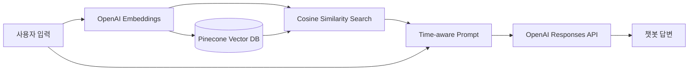

# 나동반 — Time-aware Long-term Memory Chatbot

사용자의 대화를 OpenAI 임베딩으로 변환해 Pinecone 벡터 DB에 저장하고, 현재 질문과 관련된 과거 기억을 검색해 답변에 활용하는 장기기억 챗봇입니다. 2024년 졸업 프로젝트로 제작한 프로토타입을 공개 가능한 포트폴리오 프로젝트로 재구성했습니다.

> 이 저장소에는 실제 사용자 대화, API 키, 파인튜닝 데이터 및 운영 로그가 포함되어 있지 않습니다.

## 주요 기능

- 대화 임베딩 및 의미 기반 장기기억 검색
- 기억의 생성 시간을 포함한 time-aware 프롬프트
- Pinecone 기반 영속적 벡터 저장 및 코사인 유사도 검색
- namespace를 이용한 기억 데이터 격리
- OpenAI Responses API를 이용한 근거 기반 답변 생성
- 텍스트 및 브라우저 음성 입력
- 기억 개수 확인과 전체 삭제 기능
- 테스트 가능한 계층형 구조와 기본 단위 테스트

## 시스템 구조



## 원본 프로토타입에서 개선한 점

| 구분 | 초기 프로토타입 | 공개용 리팩터링 |
|---|---|---|
| 비밀정보 | 로컬 키 파일 및 코드 내 키 | 환경변수와 `.env.example` |
| 기억 저장 | Pinecone + 로컬 JSON 이중 관리 | Pinecone metadata 단일 저장소 |
| 생성 API | 파인튜닝된 Chat Completions | Responses API, 모델 설정 가능 |
| 임베딩 | `text-embedding-ada-002` | `text-embedding-3-small` |
| 구조 | 단일 파일 중심 | 라우트·서비스·저장소 분리 |
| 보안 | 디버그 모드와 HTML 문자열 삽입 | 디버그 기본 비활성화, 안전한 DOM 렌더링 |
| 재현성 | 빈 requirements 파일 | 버전 범위와 가짜 Pinecone 인덱스를 이용한 테스트 |

## 빠른 시작

Python 3.10 이상이 필요합니다.

```bash
python -m venv .venv
```

Windows PowerShell:

```powershell
.venv\Scripts\Activate.ps1
pip install -e .
Copy-Item .env.example .env
```

macOS/Linux:

```bash
source .venv/bin/activate
pip install -e .
cp .env.example .env
```

`.env`의 `OPENAI_API_KEY`와 `PINECONE_API_KEY`를 본인의 키로 변경합니다. `.env`는 Git에 포함되지 않습니다.

Pinecone 콘솔에서 다음 설정으로 dense serverless index를 먼저 생성합니다.

- Index name: `nadongban-memory` 또는 `.env`의 `PINECONE_INDEX_NAME`
- Dimensions: `1536` (`text-embedding-3-small` 기본 차원)
- Metric: `cosine`

인덱스 host를 직접 지정하려면 `PINECONE_INDEX_HOST`를 설정할 수 있습니다.

```bash
python run.py
```

브라우저에서 <http://127.0.0.1:5000>을 엽니다.

운영 환경에 가까운 실행:

```bash
waitress-serve --call nadongban:create_app
```

## 테스트

```bash
python -m unittest discover -s tests -v
```

테스트는 Python 표준 라이브러리만 사용하며 실제 OpenAI API를 호출하지 않습니다.

## 환경변수

| 이름 | 기본값 | 설명 |
|---|---|---|
| `OPENAI_API_KEY` | 없음 | OpenAI API 키 |
| `OPENAI_CHAT_MODEL` | `gpt-5.5` | 답변 생성 모델 |
| `OPENAI_EMBEDDING_MODEL` | `text-embedding-3-small` | 임베딩 모델 |
| `PINECONE_API_KEY` | 없음 | Pinecone API 키 |
| `PINECONE_INDEX_NAME` | `nadongban-memory` | Pinecone 인덱스 이름 |
| `PINECONE_INDEX_HOST` | 없음 | 선택적 Pinecone 인덱스 host |
| `PINECONE_NAMESPACE` | `default` | 기억 격리 namespace |
| `MEMORY_TOP_K` | `5` | 검색할 최대 기억 수 |
| `MEMORY_MIN_SCORE` | `0.20` | 최소 코사인 유사도 |
| `FLASK_DEBUG` | `false` | Flask 디버그 모드 |

## 개인정보와 보안

- 실제 인물의 대화 및 개인정보를 공개 저장소에 커밋하지 마세요.
- API 키는 코드나 프런트엔드에 넣지 말고 환경변수 또는 비밀관리 서비스를 사용하세요.
- 이미 노출된 키는 저장소에서 지우는 것만으로 부족합니다. 제공자 콘솔에서 폐기한 뒤 새로 발급하세요.
- 사용자 대화는 Pinecone metadata에 저장됩니다. 실제 서비스로 확장할 때는 사용자별 namespace, 인증, 보존기간 및 삭제 정책이 필요합니다.

## 프로젝트 배경

초기 버전은 Flask, OpenAI, Pinecone, 로컬 JSON 파일을 이용해 다음 과정을 직접 구현했습니다.

1. 사용자 발화와 시간 정보를 결합
2. 발화를 임베딩하고 Pinecone에 저장
3. 현재 질문과 유사한 과거 발화 검색
4. 검색 결과와 현재 질문을 파인튜닝 모델에 전달
5. 답변 및 학습용 대화 데이터 기록

공개 버전은 Pinecone이라는 핵심 기술을 유지하면서 로컬 JSON 의존성을 없애고, 발화와 생성시간을 vector metadata에 함께 저장하도록 다시 설계했습니다.

## 향후 개선

- 사용자별 namespace 자동 발급 및 접근 제어
- 기억 중요도와 시간 감쇠를 반영한 하이브리드 랭킹
- 사용자별 인증 및 메모리 격리
- 기억 수정·삭제 UI와 출처 표시
- 평가 데이터셋을 이용한 검색 정확도 측정
